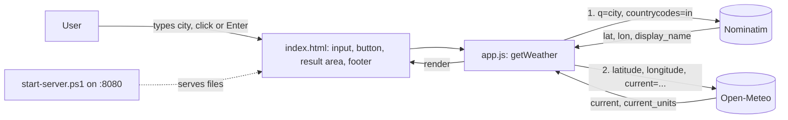
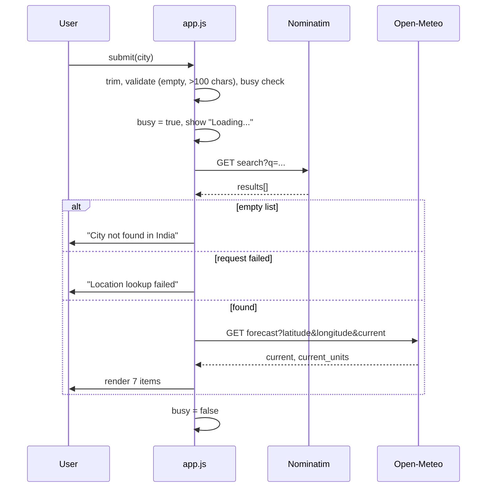

# Design Document

## Overview

The India Weather App is a static page (`index.html` plus `app.js`) that takes a city name, finds its coordinates with Nominatim, then fetches current conditions from Open-Meteo. Both calls go straight from the browser with `fetch`. There is no build step, server code, caching, class, or API key. A PowerShell script (`start-server.ps1`) serves the files on http://localhost:8080 for the demo. Because all paths are relative and nothing is server-side, the same files can later be deployed to Netlify or S3/CloudFront unchanged.

### Design decisions

| Decision | Rationale |
|---|---|
| Plain functions in one `app.js`, no classes | Required by the steering file; keeps the 20-minute demo readable. |
| Render the Result_Area by setting `textContent` / building DOM nodes, not `innerHTML` with API strings | `display_name` comes from a third party. This avoids HTML injection at no extra cost. |
| A `busy` boolean guards submissions | Meets "one lookup at a time" (Req 1.6) without extra machinery. |
| `AbortController` with a 10 s `setTimeout` per request | Meets the timeout rules (Req 2.4, 3.6) using only built-in APIs. |
| Values printed exactly as returned, unit appended from `current_units` | Meets Req 4.2 and 4.3 (no rounding or conversion). |
| Lookup table as a plain object keyed by integer code | Simple, and unknown codes fall through to a default. |

### Research summary

- Nominatim search accepts `q`, `countrycodes=in`, `format=json`, `limit=1`, and returns an array. Each item has string `lat`, `lon` and a `display_name`. It allows browser CORS requests. Its usage policy asks for light use, which fits a demo.
- Open-Meteo `/v1/forecast` accepts `latitude`, `longitude`, `current=...`, `timezone=Asia%2FKolkata` and returns `current` and `current_units` objects. It needs no key and allows CORS.
- Both facts are taken from the steering file, which states they were verified.

## Architecture





### Files

| File | Purpose |
|---|---|
| `index.html` | Markup, inline CSS (20 lines or fewer), footer, `<script src="app.js">`. |
| `app.js` | All logic. |
| `start-server.ps1` | Local static server on port 8080. |
| `start-server.bat` | Created only if path issues occur when starting the script. |

## Components and Interfaces

### index.html

- `<input id="city">` with a placeholder, `<button id="go">Get Weather</button>`, `<div id="result"></div>`, and `<footer>Weather data: Open-Meteo. Location data: OpenStreetMap Nominatim.</footer>`.
- The footer is static markup placed after `#result`, so it is visible in every state (Req 7.2).
- The script is loaded by relative path (`app.js`) at the end of `<body>`.

### app.js

Plain top-level functions and constants:

| Name | Signature | Responsibility |
|---|---|---|
| `WEATHER_CODES` | object | Maps each integer code to its description (0, 1-3, 45/48, 51-57, 61-67, 71-77, 80-82, 95-99). |
| `describeCode(code)` | `(any) -> string` | Returns the table entry, or `"Unknown conditions"` if the code is missing, not an integer, or not listed. |
| `fetchJson(url)` | `(string) -> Promise<object>` | `fetch` with a 10 s abort timer. Throws on network error, timeout, or non-OK status. |
| `showText(message)` | `(string) -> void` | Clears `#result` and sets plain text (used for Loading and errors). |
| `showWeather(place, current, units, description)` | `-> void` | Clears `#result` and builds seven labelled lines. |
| `formatValue(value, unit)` | `(any, string) -> string` | Returns `"N/A"` for null or missing values; otherwise the value exactly as returned followed by the unit. |
| `getWeather()` | `() -> Promise<void>` | Orchestrates validation, both requests, and rendering. |

Event wiring: the button `click` and the input `keydown` (Enter) both call `getWeather()`.

#### getWeather flow

1. If `busy`, return. Read `city = input.value.trim()`.
2. If `city === ""`, `showText("Please enter a city name")` and return. No request is sent and the input is left alone.
3. If `city.length > 100`, show "City name is too long (maximum 100 characters)" and return.
4. Set `busy = true`, `showText("Loading...")`.
5. `try`:
   - `places = await fetchJson(nominatimUrl)` where the URL is `https://nominatim.openstreetmap.org/search?q=` + `encodeURIComponent(city)` + `&countrycodes=in&format=json&limit=1`. A failure here shows "Location lookup failed. Please try again."
   - If `places` is empty, show "City not found in India" and stop.
   - Read `lat`, `lon`, `display_name` from `places[0]`. Build the Open-Meteo URL with `encodeURIComponent` on `lat` and `lon`, the `current=` list from the steering file, and `timezone=Asia%2FKolkata`.
   - `data = await fetchJson(weatherUrl)`. If `data.current` is missing, treat it as a failure.
   - `showWeather(display_name, data.current, data.current_units, describeCode(data.current.weather_code))`.
6. `catch` of a weather failure: show "Weather data could not be retrieved. Please try again."
7. `finally`: `busy = false`.

The two stages use separate `try` blocks (or a stage variable) so the geocoder failure and the weather failure show their own messages.

## Data Models

No persistent data. In-memory shapes only:

```js
// Nominatim result (first element used)
{ lat: "18.5213738", lon: "73.8545071", display_name: "Pune, ..., India" }

// Open-Meteo response (fields used)
{
  current: {
    temperature_2m, apparent_temperature, relative_humidity_2m,
    wind_speed_10m, precipitation, weather_code
  },
  current_units: {
    temperature_2m: "°C", apparent_temperature: "°C",
    relative_humidity_2m: "%", wind_speed_10m: "km/h", precipitation: "mm"
  }
}
```

Module state: one boolean, `busy`.

### Local server (start-server.ps1)

- Creates an `HttpListener` with prefix `http://localhost:8080/`, calls `Start()` inside `try`/`catch`. On failure it prints the error and exits without printing the success line. On success it prints `Serving on http://localhost:8080`.
- Root folder is `$PSScriptRoot`. Path `/` maps to `index.html`.
- For each request: decode the path, combine it with the root using `[IO.Path]::GetFullPath`, and return 404 unless the result starts with the root folder path (blocks `..` traversal). Return 404 if the file does not exist. The loop continues after a 404.
- Content type: `.html` gives `text/html`, `.js` gives `application/javascript`, anything else `application/octet-stream`.
- It is started as a background process (`control_pwsh_process`), never as a blocking command. If it fails for path reasons, `start-server.bat` runs `powershell -ExecutionPolicy Bypass -File "%~dp0start-server.ps1"`.

## Error Handling

| Situation | Behavior |
|---|---|
| Empty or whitespace input | "Please enter a city name"; no requests, no Loading. |
| Input over 100 characters | "City name is too long" message; no requests. |
| Submit while a lookup runs | Ignored (`busy`). |
| Nominatim returns `[]` | "City not found in India"; previous weather cleared; no weather request. |
| Nominatim network error, non-OK status, or timeout over 10 s | "Location lookup failed"; previous weather cleared. |
| Open-Meteo network error, non-OK status, timeout, or no `current` | "Weather data could not be retrieved"; no partial values. |
| Null or missing numeric value | Shown as "N/A"; other items still shown. |
| Unknown or missing `weather_code` | "Unknown conditions"; other items still shown. |
| Port 8080 busy or listener fails | Script prints the cause and exits without the "Serving" line. |

Every path ends with `busy = false`, and every error replaces "Loading..." because `showText` clears the Result_Area first.

## Testing Strategy

Property-based testing does not apply here, so the design has no Correctness Properties section. The logic is a thin layer of browser UI and calls to two external APIs, and the only pure pieces (a small lookup table and a null check) gain nothing from 100 random iterations. Requirement 10.4 also forbids test files and frameworks.

Verification is deliberately minimal:

1. **Syntax check:** run `node --check app.js` from the project folder. It must exit with code 0 and no output (Req 10.1).
2. **Manual smoke test:** start `start-server.ps1` as a background process, open http://localhost:8080, submit "Pune", and confirm all seven values appear within 10 seconds (Req 10.2, 10.3).
3. **Quick manual error checks (optional, during the demo):** submit an empty input, and a nonsense name such as "zzzzqq", to see the two messages.
4. **Review check:** confirm `app.js` contains no National Weather Service or IMD URL, and the folder contains no deployment or test files (Req 8.6, 8.7, 10.4).
